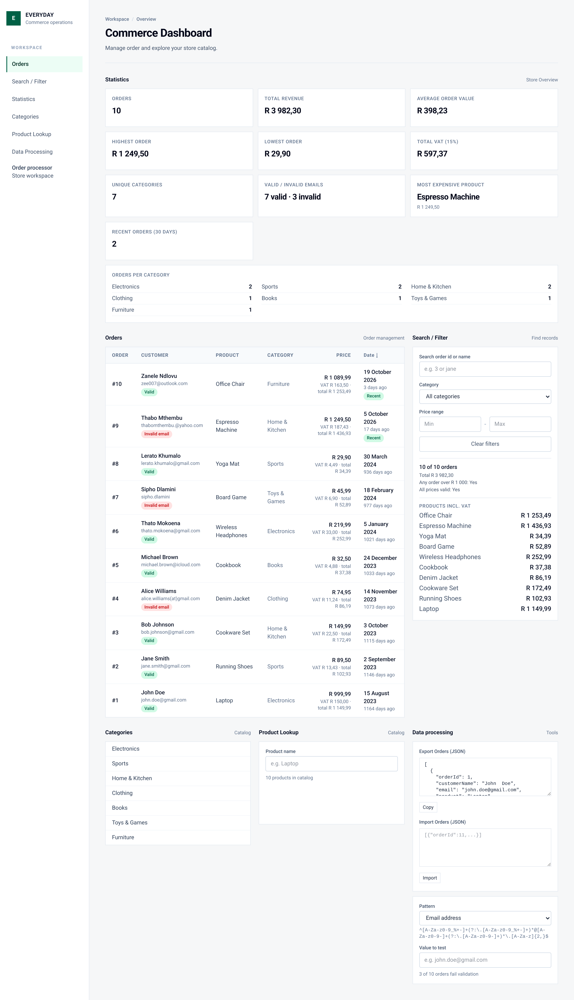
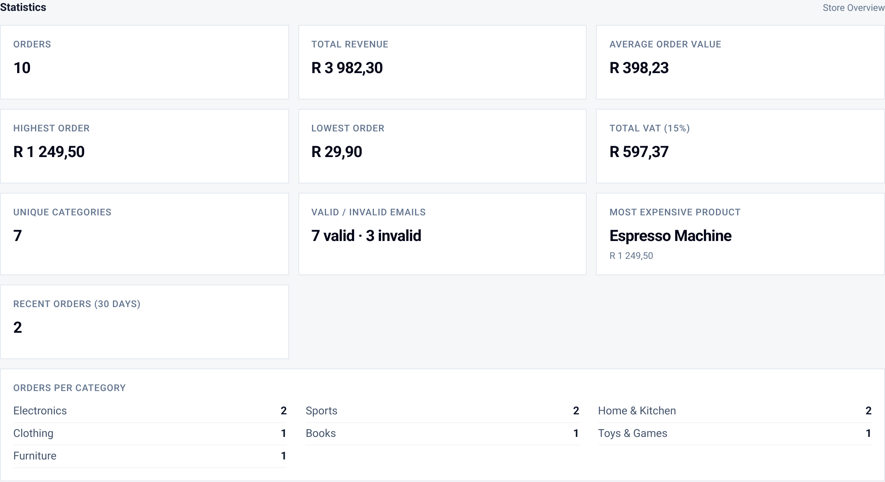
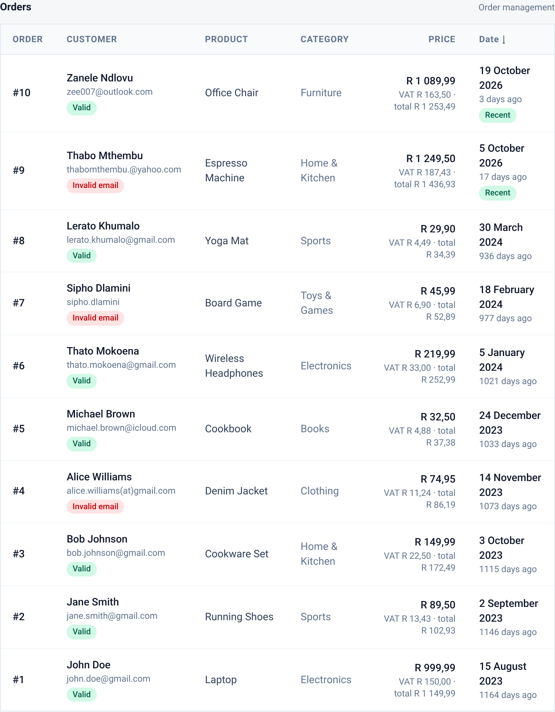
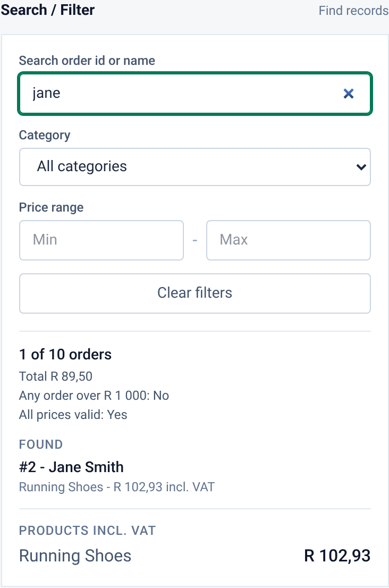
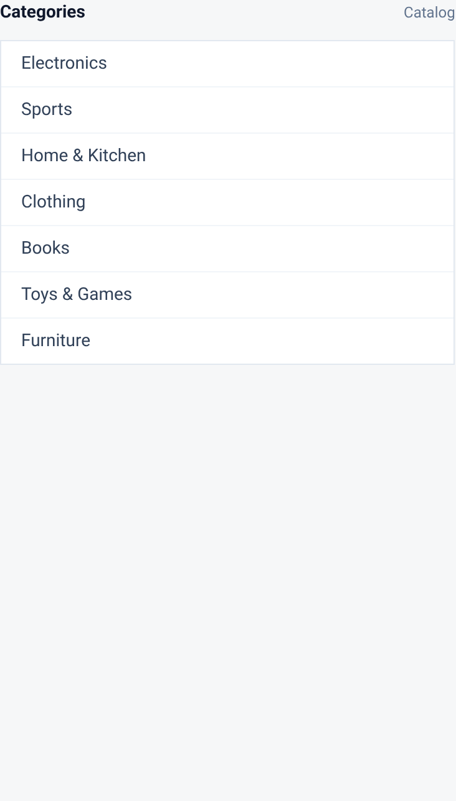
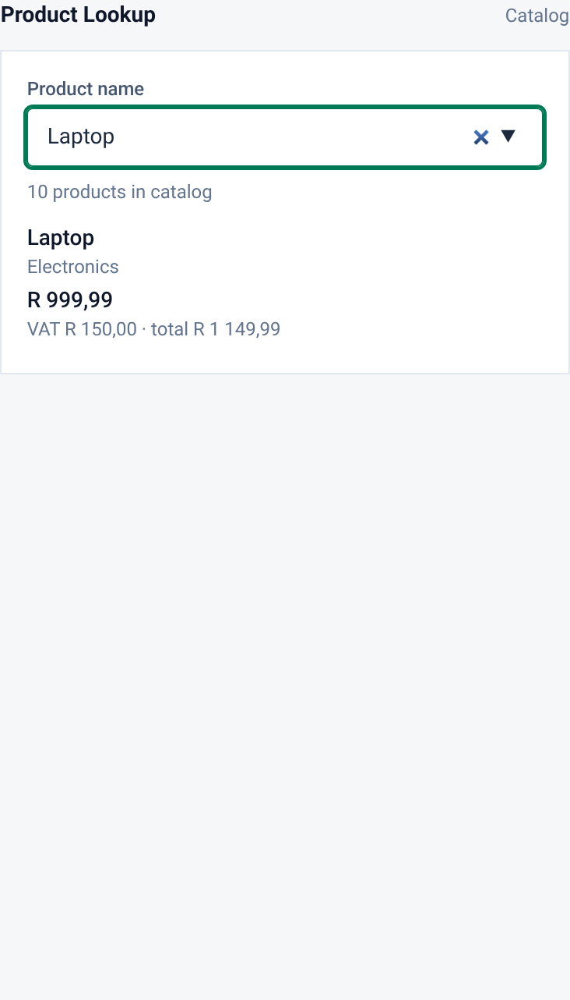
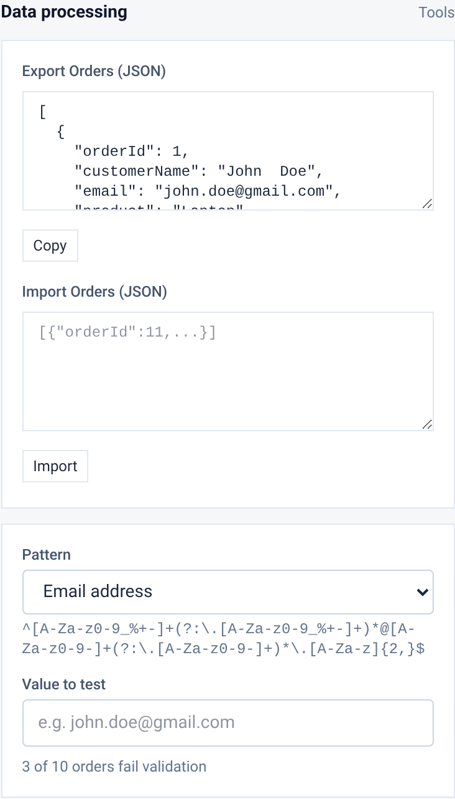

# E-Commerce Order Processor

## Project Description

A client-side e-commerce order dashboard for viewing and processing orders. It displays order details, calculates revenue/statistics, cleans customer data, sorts by date, shows unique categories, supports JSON export/import, and validates customer emails and order ids with regular expressions. The Statistics section summarises the whole dataset: order count, revenue, average, highest/lowest order, VAT, unique categories, orders per category, valid/invalid emails, most expensive product and recent orders. Every statistic recalculates whenever the dataset changes (for example after a JSON import).

## Technologies

- HTML
- Tailwind CSS
- JavaScript

## Built-In Objects Used

| Built-In Object | Where Used in the Project |
| --------------- | --------------------------- |
| `String` | `cleanName()` (trimming, splitting, case conversion), `cleanEmail()` (trimming, lowercasing), `firstName()`, `emailDomain()` |
| `Number` | Price parsing/handling in totals (`parseFloat`), numeric calculations for VAT and averages |
| `Math` | `Math.round()` for VAT and averages, `Math.floor()` for days calculation, `Math.max()`/`Math.min()` for highest/lowest orders |
| `Date` | `orderDateObject()` (`new Date()`), `readableDate()` (`toLocaleDateString()`), `daysSince()` (`Date.now()`), sorting by date, `isRecentOrder()` for the recent orders statistic |
| `Array` | Order data structure, `map()`, `reduce()`, `filter()`, `sort()`, spread `[...orders]`, concatenation on import |
| `Set` | `getUniqueCategories()` to build unique categories from orders |
| `Map` | Product lookup catalog (`buildProductMap()`, `findProduct()`), orders per category (`categoryCounts()`) |
| `JSON` | `JSON.stringify()` in export, `JSON.parse()` in import with try/catch |
| `RegExp` | Whitespace normalization in `cleanName()` (`/\s+/`) and `cleanEmail()` (`/\s+/g`); validation patterns (`EMAIL_PATTERN`, `ORDER_ID_PATTERN`) with `.test()` in Challenge 8; email validity counts in the statistics |
| `Intl` | `Intl.NumberFormat` for ZAR currency formatting |

## How to Run

1. Clone or download the project files.
2. Open `index.html` in a modern web browser (no build step required). All dependencies (Tailwind CSS) load via CDN.

## Screenshots

### Dashboard overview

### Statistics dashboard

### Orders displayed

### Searching and filtering

### Unique categories

### Product lookup

### JSON export and import

## Reflection

1. **Which built-in JavaScript object did you find most useful?**  
   

2. **Which challenge was the most difficult?**  
   

3. **What did you learn about choosing the right JavaScript method for a problem?**  
   

4. **If you had more time, what would you improve about the application?**  
   

   
